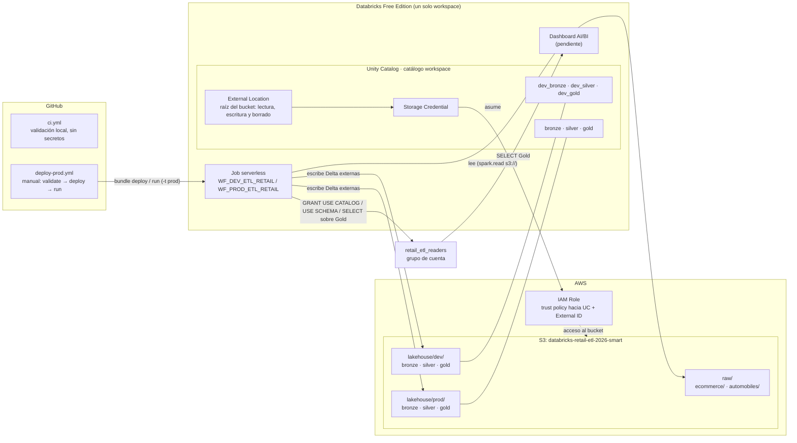
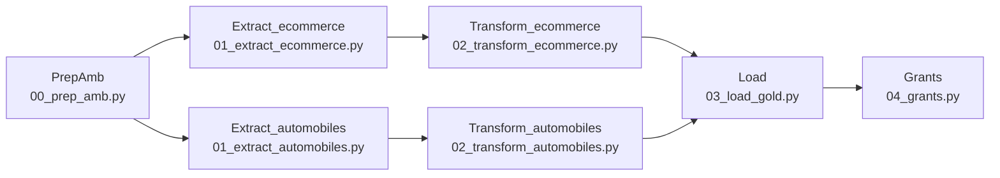
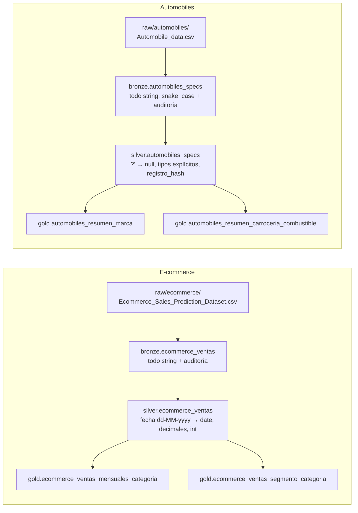

# Diagramas

Fuente editable en [Mermaid](https://mermaid.js.org/), que GitHub muestra directamente. `scripts/validar_repo.py` comprueba
que el diagrama del job coincide con las dependencias de [resources/wf_prod_etl_retail.job.yml](../resources/wf_prod_etl_retail.job.yml)
y que aparecen todas las tablas de `comun.TABLAS`. Si cambia el job o las tablas, hay que actualizar este archivo.

## 1. Arquitectura

- RAW se lee directamente desde S3, gobernado por la External Location: no se usan DBFS ni Volúmenes.
- La External Location cubre la raíz del bucket con lectura, escritura y borrado. Que los notebooks solo lean `raw/` y solo
  escriban en `lakehouse/<entorno>/` lo garantiza el código, no el almacenamiento.
- IAM Role y Managed Identity no son el mismo mecanismo ([D1](decisiones_y_pendientes.md#d1-acceso-a-raw-managed-identity-enunciado-frente-a-iam-role-de-aws-implementación)).
- La ejecución de prod y de GitHub Actions todavía no ha ocurrido. dev se despliega desde el CLI local.

## 2. Flujo del job (tareas y dependencias)

## 3. Medallion por fuente (sin cruces entre fuentes)

En dev, los esquemas se llaman `dev_bronze`, `dev_silver` y `dev_gold`, y los datos van a `lakehouse/dev/`. En prod se usan
`bronze`, `silver` y `gold`, en `lakehouse/prod/`.
